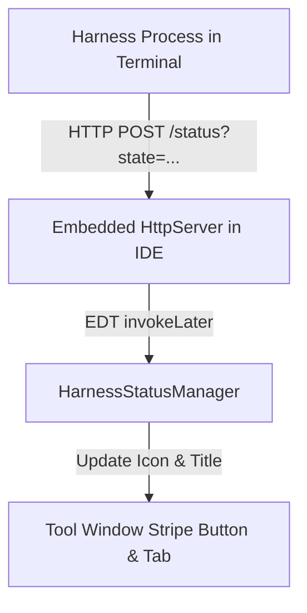

# Harness Aside — Development Plan & Multi-Harness Architecture

## 1. Problem & Vision

`harness-aside` (formerly `harness-aside`) embeds AI coding harnesses directly into a dedicated tool window docked on the **right** (next to Gradle/Database/Maven), keeping the primary bottom terminal area clean for regular compilation, git commands, and shell operations.

While the initial version focused exclusively on Claude Code, the project is being restructured into a **multi-harness platform**, supporting:
- 🟠 **Claude Code** (`claude -c`)
- 🔵 **Antigravity CLI** (`agy`)
- 🟣 **OpenCode CLI** (`opencode`)

---

## 2. Analiza stanu obecnego i refaktoryzacja

### Stan pierwotny (`harness-aside`)
- `ClaudeToolWindowFactory.kt`: Używał `LocalTerminalDirectRunner` do uruchomienia widgetu terminala JetBrains w prawym docku i wysyłał polecenie startu sesji Claude.
- `ClaudeTerminalService.kt`: Zarządzał kartami terminala i wstrzykiwaniem komend.
- `ClaudeStatusService.kt`: Odczytywał stan Claude przez odpytywanie plików w `.claude/aside-status` i tail transcriptu JSONL.
- `plugin.xml`: Rejestrował jedno okno narzędziowe.

### Nowy kierunek (`harness-aside`)
Claude Code staje się **jednym z obsługiwanych harnessów**. Architektura zostaje ujednolicona wokół interfejsu harnessu, z dedykowanym widokiem startowym (Launcher Panel), ścisłą zasadą jednej aktywnej karty oraz lekkim protokołem IPC powiadamiania o statusie.

---

## 3. Architektura: Lightweight & Minimalne Obciążenie CPU

Aby plugin nie obciążał procesora i działał płynnie, kluczowy jest wybór sposobu wykrywania stanu agenta:

### Czego unikać (Antywzorzec):
- ❌ **Scraping / parsing bufora terminala (ANSI regex):** Odczytywanie tekstu z terminala w pętli pollera pożera mnóstwo CPU, zawiesza wątek UI (EDT) i jest skrajnie niestabilne ze względu na dynamiczne przerysowywanie TUI (biblioteki Ink/Bubbletea/Curses czyszczą linie i nadpisują ekran).

### Rekomendowane rozwiązanie: Push-based Event IPC (Zero CPU w spoczynku)
- ✔️ **Lokalny mikro-odbiornik HTTP/Socket (Localhost Loopback):**
  - Podczas inicjalizacji okna, plugin uruchamia w pamięci mikroserwer (np. standardowy `com.sun.net.httpserver.HttpServer` z JDK na losowym porcie 127.0.0.1 lub ephemeral TCP port).
  - Przy starcie terminala plugin wstrzykuje do zmiennych środowiskowych powłoki:
    ```bash
    HARNESS_IDE_PORT=49152
    HARNESS_IDE_TOKEN=secret_xyz
    ```
  - Hooki i pluginy w danym harnessie wykonują jedno mikrosekundowe żądanie (np. `curl -s -X POST http://127.0.0.1:$HARNESS_IDE_PORT/status?state=thinking` lub JS `fetch()`).
  - **Koszt CPU:**
    - W spoczynku: **0.00%** (brak pętli, brak timerów, selektor asynchroniczny).
    - Podczas zmiany stanu: dokładnie jedno zdarzenie i przełączenie ikony.



---

## 4. Logika "Tylko JEDNA karta" i Wybór Harnessu

Wymóg posiadania maksymalnie jednej aktywnej karty realizowany jest poprzez prostą maszynę stanów w Tool Window:

```
[ Brak aktywnej sesji ] ──► Widok wyboru (Launcher Panel)
                                │
                                ├── Kliknięcie "Claude Code"
                                ├── Kliknięcie "Antigravity CLI"
                                └── Kliknięcie "OpenCode CLI"
                                │
                                ▼
[ Aktywna sesja ]       ──► Widok Terminala (Dokładnie 1 Content)
                                │
                                └── Pasek narzędzi (Toolbar):
                                      [Przełącz / Zakończ sesję] ──► Powrót do Launchera
```

### 1. Widok Launchera (Empty State):
- Panel Swing z 3 estetycznymi kafelkami/przyciskami:
  - 🟠 **Claude Code** (`claude -c`)
  - 🔵 **Antigravity CLI** (`agy`)
  - 🟣 **OpenCode CLI** (`opencode`)
- Opcja: checkbox "Wznów ostatnią sesję" / "Pamiętaj wybór dla projektu".

### 2. Obsługa pojedynczej karty (`ContentManager`):
- Po wybraniu harnessu zawartość okna jest zastępowana przez widget terminala.
- Flaga `content.isCloseable = true`: zamknięcie karty niszczy proces i przywraca widok launchera.
- Dodatkowy przycisk na pasku narzędzi (Tool Window Header Action): "Switch Harness" / "Reset Session", który pozwala bezpiecznie zakończyć obecną sesję i wrócić do wyboru.

---

## 5. Animowane Ikonki i Stany Agenta

IntelliJ SDK posiada wbudowane wsparcie dla animowanych ikon: `com.intellij.ui.AnimatedIcon`.

- **Wydajność:** `AnimatedIcon` wstrzymuje renderowanie i odświeżanie klatek w momencie, gdy Tool Window jest ukryte lub zminimalizowane, dzięki czemu nie marnuje zasobów w tle.
- **Stany do obsłużenia:**
  - `IDLE`: Statyczna ikonka wybranego harnessu (lub zielona kropka).
  - `THINKING` / `GENERATING`: `AnimatedIcon.Default` (subtelny spinner JetBrains) lub animowany pierścień w barwach danego harnessu.
  - `EXECUTING_TOOL`: Animowana zębatka lub pulsująca ikonka narzędzia.
  - `WAITING_PERMISSION` / `INPUT`: Statyczna pomarańczowa ikonka uwagi / dzwonka (z opcją desktop notification).
  - `ERROR`: Czerwony wykrzyknik.

---

## 6. Zescope'owanie poszczególnych Harnessów

Każdy z trzech harnessów ma inny mechanizm rozszerzeń i raportowania zdarzeń:

| Cecha | Claude Code | Antigravity CLI (`agy`) | OpenCode CLI (`opencode`) |
|---|---|---|---|
| **Główna komenda** | `claude` (`claude -c`) | `agy` | `opencode` |
| **Mechanizm zdarzeń** | Hooks w `.claude/settings.json` | Hooks w `.agents/hooks.json` | Pluginy JS/TS w `.opencode/plugins/` |
| **Wspierane cykle życia** | `UserPromptSubmit`, `PreToolUse`, `PostToolUse`, `Stop`, `Notification` | `PreInvocation`, `PreToolUse`, `PostToolUse`, `PostInvocation`, `Stop` | `session.status`, `session.idle`, `toolExecuted` |
| **Sposób powiadamiania** | Shell command (`curl` do IDE) | Shell command w `hooks.json` | Native `fetch()` w pluginie Node/Bun |

---

### A. Claude Code

Claude Code wspiera deklaratywne hooki w `~/.claude/settings.json` lub `.claude/settings.json`:
- **Zdarzenia:**
  - `UserPromptSubmit`: agent rozpoczyna pracę (`THINKING`)
  - `PreToolUse`: agent wykonuje narzędzie (`EXECUTING_TOOL`)
  - `PostToolUse`: zakończenie narzędzia (`THINKING`)
  - `Stop` / `SessionEnd`: zakończenie odpowiedzi (`IDLE`)
  - `Notification`: oczekiwanie na decyzję użytkownika (`WAITING_PERMISSION`)
- **Implementacja w hooku:**
  ```json
  {
    "hooks": {
      "UserPromptSubmit": [{ "type": "command", "command": "curl -s -X POST http://127.0.0.1:$HARNESS_IDE_PORT/status?state=thinking" }],
      "PreToolUse": [{ "type": "command", "command": "curl -s -X POST http://127.0.0.1:$HARNESS_IDE_PORT/status?state=tool" }],
      "Stop": [{ "type": "command", "command": "curl -s -X POST http://127.0.0.1:$HARNESS_IDE_PORT/status?state=idle" }]
    }
  }
  ```

---

### B. Antigravity CLI (`agy`)

Antigravity posiada system cyklu życia definiowany w `.agents/hooks.json` (lub w pluginach Antigravity):
- **Zdarzenia:**
  - `PreInvocation`: model został wywołany (`THINKING`)
  - `PreToolUse`: uruchomienie narzędzia (`EXECUTING_TOOL`)
  - `PostToolUse` / `PostInvocation`: powrót do pętli decyzyjnej
  - `Stop`: zakończenie pętli wykonawczej (`IDLE`)
- **Kontrakt:** Hook otrzymuje na stdin JSON z metadanymi i oczekuje JSON-a na stdout.
- **Implementacja w `.agents/hooks.json`:**
  ```json
  {
    "ide-status": {
      "PreInvocation": [{ "type": "command", "command": "curl -s -X POST http://127.0.0.1:$HARNESS_IDE_PORT/status?state=thinking" }],
      "PreToolUse": [{ "matcher": "*", "hooks": [{ "command": "curl -s -X POST http://127.0.0.1:$HARNESS_IDE_PORT/status?state=tool" }] }],
      "Stop": [{ "type": "command", "command": "curl -s -X POST http://127.0.0.1:$HARNESS_IDE_PORT/status?state=idle" }]
    }
  }
  ```

---

### C. OpenCode CLI (`opencode`)

OpenCode opiera się o ekosystem pluginów JS/TS ładowanych z `.opencode/plugins/` lub konfigurowanych w `opencode.jsonc`:
- **Zdarzenia:**
  - `session.status`: zmiana statusu sesji
  - `session.idle`: przejście w stan spoczynku
  - zdarzenia wykonania narzędzi
- **Implementacja pluginu OpenCode (`.opencode/plugins/intellij-bridge.js`):**
  Zero dodatkowych zależności (wykorzystuje natywny `fetch` środowiska Node/Bun):
  ```javascript
  export default {
    id: "intellij-bridge",
    setup(ctx) {
      const port = process.env.HARNESS_IDE_PORT;
      if (!port) return;

      const notify = (state) => {
        fetch(`http://127.0.0.1:${port}/status?state=${state}`).catch(() => {});
      };

      ctx.event.subscribe((event) => {
        if (event.type === "session.idle") notify("idle");
        else if (event.type === "session.status") notify("thinking");
      });
    }
  };
  ```

---

## 7. Dystrybucja hooków (Zero-Config dla użytkownika)

Aby użytkownik nie musiał ręcznie konfigurować plików JSON/JS w każdym projekcie:
1. **Wspólny katalog mostka pluginu:**
   - Plugin IntelliJ tworzy w swoim katalogu cache (np. `~/.config/harness-aside/hooks/` lub tymczasowym w projekcie) zestaw lekkich skryptów powiadamiających.
2. **Automatyczna inicjalizacja:**
   - Przed uruchomieniem terminala plugin sprawdza i dopisuje reguły do konfiguracji projektu (`.claude/`, `.agents/`, `.opencode/`), lub:
   - Wstrzykuje flagi konfiguracyjne do powłoki/procesu, wskazujące na globalne konfiguracje dostarczone przez plugin.

---

## 8. Scoping i Plan Prac (Krok po Kroku)

### Zadanie 1: Rebranding i Architektura UI (Karty i Launcher)
- [x] Zmiana nazwy i identyfikatorów (`harness-aside`, `Harness Aside`, `com.github.baenar.harnessaside`).
- [ ] Implementacja widoku `LauncherPanel` (estetyczny wybór Claude Code, Antigravity CLI, OpenCode CLI).
- [ ] Zapewnienie ścisłej reguły 1 aktywnej karty w `ToolWindowContentManager`.
- [ ] Dodanie akcji na pasku narzędzi: *Switch Harness* (zamknięcie aktywnego procesu i powrót do launchera).

### Zadanie 2: Lightweight Status Bridge (Mikroserwer HTTP)
- [ ] Implementacja serwera `HarnessStatusServer` (użycie standardowego `com.sun.net.httpserver.HttpServer` z JDK, powiązanego z cyklem życia `Disposable` projektu).
- [ ] Przekazywanie `HARNESS_IDE_PORT` (oraz opcjonalnego tokenu) do środowiska terminala w `ShellStartupOptions.Builder().env(...)`.
- [ ] Endpoint `POST /status?state=...` aktualizujący stan na wątku EDT (`ApplicationManager.getApplication().invokeLater`).

### Zadanie 3: System Animowanych Ikon
- [ ] Przygotowanie zestawu ikon SVG dla każdego harnessu + ikon stanu (`IDLE`, `THINKING`, `TOOL`, `INPUT`, `ERROR`).
- [ ] Podpięcie `AnimatedIcon` pod nagłówek karty oraz ikonę okna w pasku bocznym (Stripe button).

### Zadanie 4: Integracja Hooków dla Harnessów
- [ ] Przygotowanie szablonów hooków dla Claude Code (`.claude/settings.json`).
- [ ] Przygotowanie konfiguracji hooków dla Antigravity CLI (`.agents/hooks.json`).
- [ ] Przygotowanie wbudowanego pluginu dla OpenCode (`.opencode/plugins/intellij-bridge.js`).
- [ ] Automatyczna weryfikacja/instalacja mostka statusów przy starcie wybranego harnessu.
